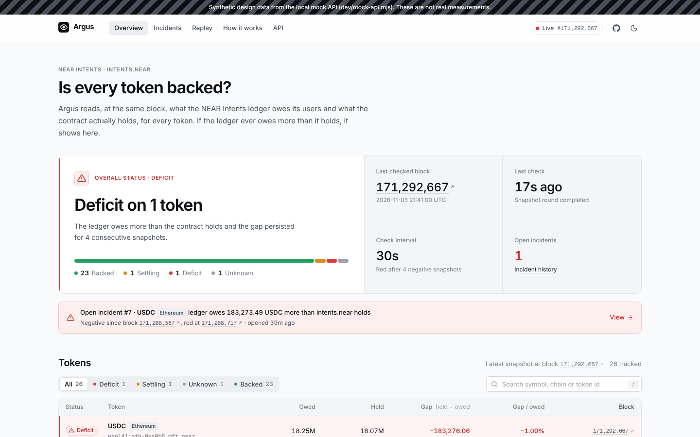
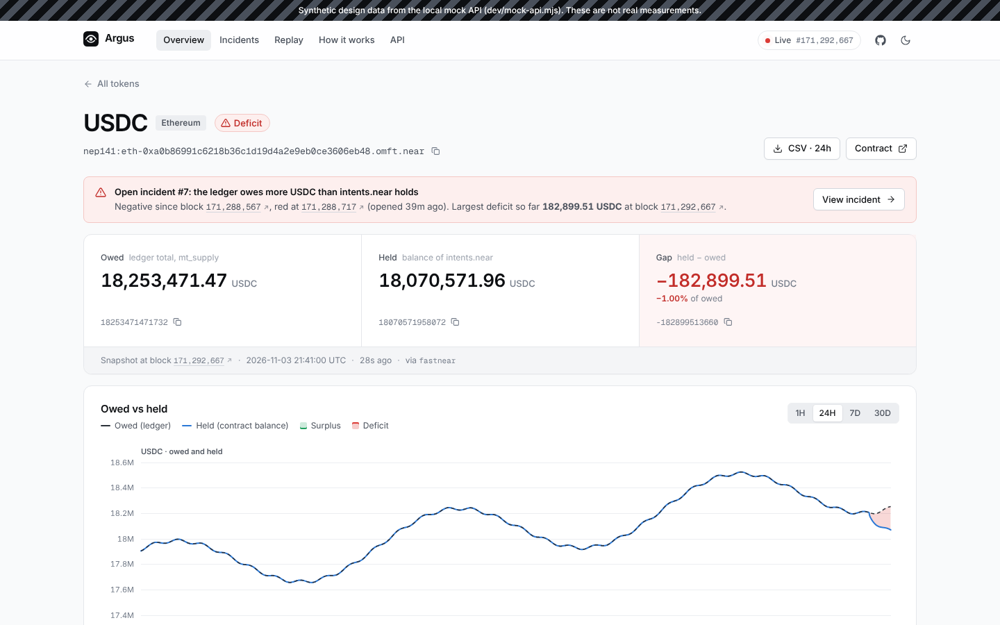
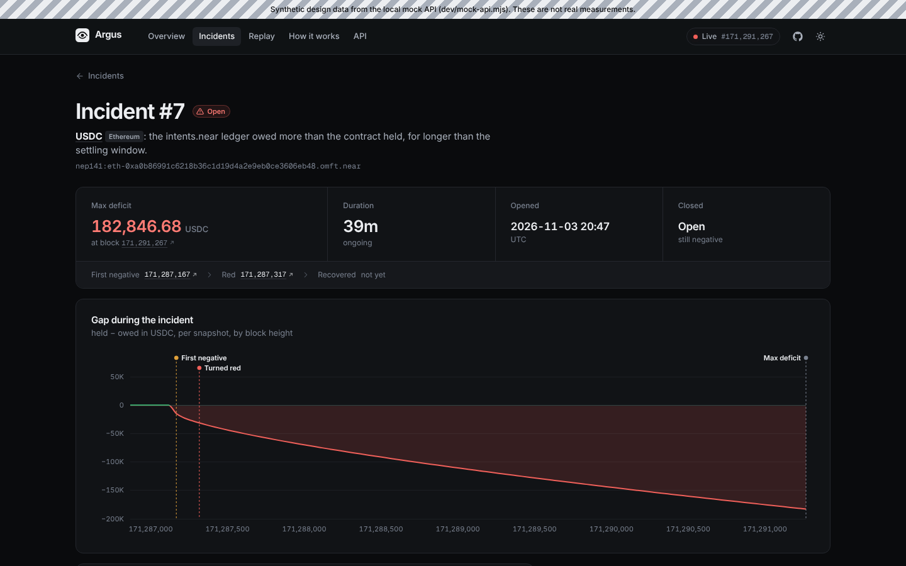
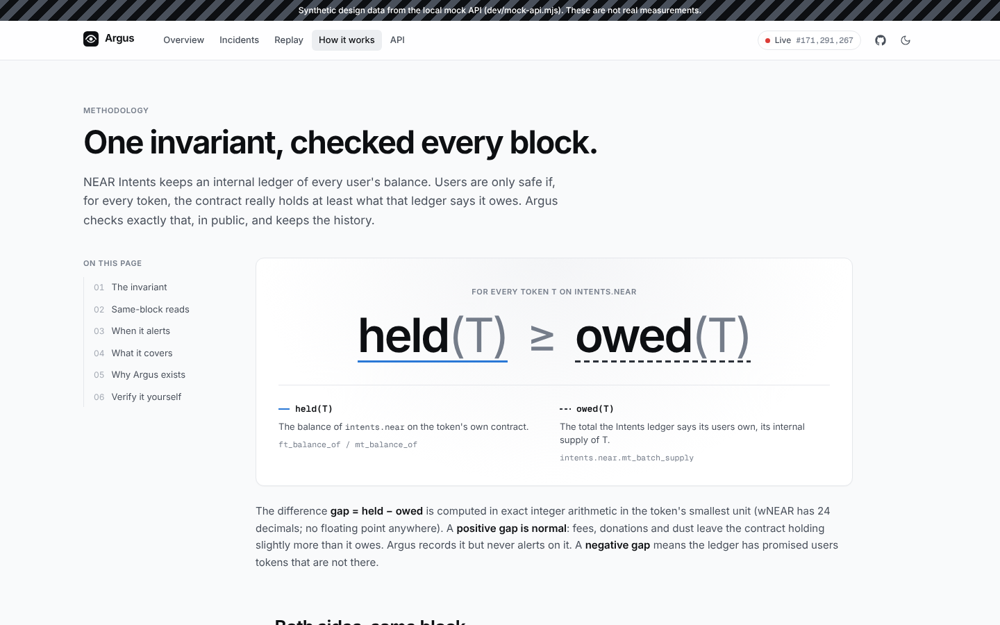

# Argus

**An independent, public monitor that keeps checking whether NEAR Intents actually holds the tokens it owes its users, token by token, and raises the alarm the moment it doesn't.**



<sub>Screenshot rendered from the dashboard's dev-only mock API; the striped banner marks the numbers as synthetic. See [Status of this build](#status-of-this-build) for what has and has not been run against mainnet.</sub>

---

## The problem

NEAR Intents (`intents.near`) keeps an internal ledger of every user's balance for every token. Users are only safe if, for every token, **the total the ledger owes is no more than the tokens the contract really holds**.

On 2026-10-01 that broke. A deposit path in the Intents contract notified a user-chosen contract; the attacker made that notification fail, so the token contract refunded the deposit while NEAR Intents kept the ledger credit. Repeated across **23 failed deposits**, this created about **$3.8M of unbacked "ghost" balances**, which were withdrawn as USDT on BNB Chain. The attacker returned the funds within about 36 hours.

The postmortem ("Postmortem: NEAR Intents October 1 Exploit", published 2026-10-16 by Alex Shevchenko, NEAR Intents) reports that monitoring compared each token's origin-chain backing with the NEAR-side totals, but **did not compare users' internal balances with the tokens the Intents contract actually held**. NEAR Intents has since removed deposit notifications ([near/intents@16d04f6](https://github.com/near/intents/commit/16d04f6ec4401263f8914638710260da50bb46b0), `defuse/v0.4.5`, 2026-10-07) and added that solvency check internally, with an automatic pause.

> **Citation status.** The official postmortem could not be opened from the build environment (X and the NEAR Intents site were blocked), so the figures above come from secondary coverage that quotes it: [The Defiant](https://thedefiant.io/news/security/near-intents-postmortem-links-3-8-million-exploit-to-deposit-bug), [Crypto Times](https://www.cryptotimes.io/2026/10/17/near-intents-traces-3-8m-exploit-to-smart-contract-deposit-bug/), [KuCoin News](https://www.kucoin.com/news/flash/near-intents-releases-post-mortem-report-on-3-8m-vulnerability), [The Block](https://theblock.co/news/ecosystems/2026-10-01-near-intents-halts-services-after-3-8-million-exploit-promises-full-compensation-417404), plus the contract history in [near/intents](https://github.com/near/intents). Replace this note with a direct link to the official post before publishing. Full notes: [docs/research.md](docs/research.md).

So the check now exists, but only inside the team. Nobody outside can see it, re-run it, or be alerted by it. **Argus is the public, reproducible version: don't trust, verify.**

**What Argus does not claim.** Argus did not discover this bug, and NEAR Intents already monitors this internally. Its value is independence, transparency and history.

## How it works

For every token NEAR Intents supports, Argus reads **at the same block** (a) how much the ledger says users own in total and (b) how much of that token the Intents contract actually holds, and records the gap. If the ledger owes more than it holds and the gap does not close within a short settling window, Argus raises an alert with the token, the size of the gap, the block where it started and the `intents.near` events in that window.

**The invariant:** for every token `T`, `held(T) >= owed(T)`.

| Side | How it is read (at `block_id = H`) |
|---|---|
| `owed(T)` | `intents.near.mt_batch_supply({"token_ids": [...]})`, the NEP-245 total supply, batched 50 ids per call |
| `held(T)` for `nep141:<contract>` | `<contract>.ft_balance_of({"account_id": "intents.near"})` |
| `held(T)` for `nep245:<contract>:<id>` | `<contract>.mt_balance_of({"account_id": "intents.near", "token_id": "<id>"})` |

`gap = held - owed`, computed with `math/big` on the raw integer strings, never floats. Both sides of a token's reading always come from the same RPC provider at the same final block; if a provider fails mid-round, the whole round is retried on the next one. Reading both sides at one block matters: reading them at different blocks would show false gaps whenever someone deposits or withdraws.

**Debounce.** A cross-contract deposit or withdrawal takes a few blocks, so one negative reading is not an incident.

```
green ──gap<0──▶ amber ──gap<0 for K consecutive snapshots (default 4, ~2 min)──▶ red ──gap>=0──▶ green
                   └──────────────gap>=0 before K (in-flight transfer, no alert)────────▶ green
```

A configurable absolute deficit threshold turns a token red immediately. On red, Argus opens an incident, sends Telegram and webhook alerts, attaches the block range and (optionally) the `intents.near` NEP-245 and DIP-4 events from that range, and keeps updating until the token is green again, then closes the incident with its duration and maximum deficit. A failed read never resets a streak; it marks the token stale.

### What it covers, and what it doesn't

| Covered | Not covered |
|---|---|
| Every `nep141` and `nep245` token that `intents.near` reports via `mt_tokens`, or the 1Click token list, or `config/tokens.yaml` | **Origin-chain backing** of bridged tokens (is `eth.omft.near` backed by ETH on Ethereum?). That is the layer NEAR Intents already monitored. Argus checks the NEAR-side layer only: is the Intents ledger backed by the bridged token it holds? |
| Ledger vs contract balance at the same final block, every 30 s | NFTs (`nep171`), out of scope for v1 |
| History, incidents, CSV export, public JSON API | `imt:` tokens, which Intents mints itself and which have no external backing to check |
| | Any write action. Argus is read-only: it never signs or sends a transaction and holds no keys |

## The October incident replay

The replay re-runs the same snapshot calculation at block heights before, during and after the exploit using archival RPC, and writes `evidence/replay-2026-10-01.{json,md}`.

**Status: not run yet.** The tooling is built (`cmd/replay`, with a request cache and a `-find-heights` helper that converts the published UTC timestamps to block heights), but the build environment could not reach archival RPC, and no public source lists the affected Intents token id or block heights. The working hypothesis, **unverified**, is HOT Omni USDT on BNB Chain, `nep245:v2_1.omni.hot.tg:56_2CMMyVTGZkeyNZTSvS5sarzfir6g`, over 2026-09-29 16:14 to 2026-10-01 05:54 UTC. The step-by-step plan is in [docs/research.md §2.4](docs/research.md). The dashboard's `/replay` page shows a "pending archival data" state until the evidence file exists. No replay numbers are presented anywhere until they come from real archival reads.

```sh
go run ./cmd/replay -find-heights 2026-09-29T16:00:00Z,2026-10-01T06:00:00Z,2026-10-01T09:00:00Z
cp evidence/replay-plan.example.yaml evidence/replay-plan.yaml   # fill in heights and token ids
make replay                                                      # writes evidence/replay-2026-10-01.{json,md}
```

## Run it in 30 seconds

```sh
make verify
```

No network, no keys, about 5 seconds. It runs the Go test suite, then replays recorded JSON-RPC exchanges through the real snapshot reader and alert engine over 12 rounds and checks the result against `expected.json`:

```
Fixture set: synthetic (not mainnet data)
Status after the last round (block 1000360)
TOKEN                                   SYMBOL                              OWED                              HELD                          GAP     GAP %  STATUS
nep141:eth.synthetic.near               ETH                               8501.2                            8496.2                           -5  -0.0588%  red
nep141:wnear.synthetic.near             wNEAR   4200018.123456789012345678901234  4200020.123456789012345678901241  +2.000000000000000000000007   0.0000%  green
...
Transitions observed
  block 1000180   DAI      turned AMBER
  block 1000210   DAI      false alarm cleared (amber -> green, never red)
  block 1000240   ETH      turned RED
Expectations: PASS (7 final statuses, 7 transitions, 4 alerts match evidence/fixtures/synthetic/expected.json)
```

The committed fixture set is **synthetic** and labelled as such (`evidence/fixtures/synthetic/README.md`); it exercises 24-decimal values, a sustained deficit, an in-flight false alarm and an NEP-245 token. Once network access is available, `go run ./cmd/verify -capture` records a real mainnet round into `evidence/fixtures/live-<block>/`, and `make verify` replays it first.

Full stack against mainnet:

```sh
cp .env.example .env     # optional: TELEGRAM_BOT_TOKEN, TELEGRAM_CHAT_ID
make run                 # Postgres, Redis, Argus on :8080, dashboard on :3000
```

## Architecture

```
            ┌──────────── NEAR mainnet (read-only) ────────────┐
            │  JSON-RPC: free.rpc.fastnear.com, rpc.mainnet…   │   neardata.xyz (blocks + logs, optional)
            └───────▲───────────────────────────▲──────────────┘            ▲
                    │ same block H, same provider│                          │
          ┌─────────┴────────┐        ┌──────────┴─────────┐       ┌────────┴────────┐
          │ tokens: discovery│        │ snapshot: owed/held │       │ events: NEP-245 │
          │ mt_tokens→1Click │        │ gap (math/big)      │       │ + DIP-4 parser  │
          │ →tokens.yaml     │        └──────────┬──────────┘       └────────┬────────┘
          └─────────┬────────┘                   │                           │ incident context
                    ▼                            ▼                           ▼
              ┌───────────────────────── Postgres (history) ──────────────────────────┐
              └───────────▲──────────────────────────────▲──────────────────────────┘
                          │                              │
               ┌──────────┴──────────┐        ┌──────────┴─────────┐     ┌──────────────────────┐
               │ alert: debounce FSM │──────▶ │ Redis queue →      │───▶ │ Telegram bot,        │
               │ incidents           │        │ dispatcher (retry) │     │ signed webhooks      │
               └─────────────────────┘        └────────────────────┘     └──────────────────────┘
                          │
               ┌──────────┴──────────┐        ┌─────────────────────┐
               │ api: /v1 JSON + CSV │◀────── │ web: SvelteKit 5    │
               │ + SVG status badges │        │ static dashboard    │
               └─────────────────────┘        └─────────────────────┘
```

| Path | Responsibility |
|---|---|
| `cmd/argus` | The monitor: discovery, snapshot loop, alert engine, dispatcher, Telegram bot, event follower, HTTP API. Flags `-once`, `-healthcheck`, `-version` |
| `cmd/verify` | Offline fixture replay for `make verify`; `-capture` records a live round |
| `cmd/replay` | Archival incident replay with a request cache; `-find-heights` maps UTC times to blocks |
| `checks/01..06` | The PRD's capability checks; each prints PASS/FAIL and saves raw responses to `evidence/checks/` |
| `internal/rpc` | NEAR JSON-RPC client: `call_function` at a `block_id`, provider fallback, per-provider rate limits, typed NEAR errors |
| `internal/tokens` | Token id parsing, held-balance readers, discovery chain, chain labels |
| `internal/snapshot` | Pure gap math and the batched same-block round |
| `internal/alert` | Debounce state machine, incident engine, reliable Redis queue, Telegram and webhook notifiers |
| `internal/events` | neardata block reader, NEP-245 and DIP-4 event parser, incident attacher |
| `internal/store` | Postgres repository; amounts are `NUMERIC(78,0)` end to end. Migrations in `migrations/` |
| `internal/api` | Read-only HTTP API ([docs/api.md](docs/api.md)) |
| `web/` | SvelteKit dashboard ([web/README.md](web/README.md)) |

**API** (no auth, rate-limited, CORS open): `GET /v1/status`, `/v1/tokens`, `/v1/tokens/{id}`, `/v1/tokens/{id}/history`, `/v1/incidents`, `/v1/incidents/{id}`, `/v1/export.csv`, `/v1/replay`, and embeddable badges at `/v1/badge/{id}.svg` and `/v1/badge/all.svg`.

## Dashboard

| Token detail | Incident | How it works |
|---|---|---|
|  |  |  |

Overview with per-token status sorted by risk, token detail with an owed-vs-held chart and the exact RPC calls behind each number, incidents with attached events, the replay page, an explainer and an API reference. Light and dark themes; works at phone width. These screenshots use the mock API's synthetic data.

## Measured results

| Metric | Value |
|---|---|
| Tokens covered | 26 in the committed fallback list (from NEAR Intents' production token list). The live count from `mt_tokens` / 1Click is not yet measured |
| Check interval | 30 s (configurable), K = 4 consecutive negative snapshots to alert, so a sustained deficit alerts about 2 minutes after it appears |
| Time to detect in the replay | Not yet measured (replay not run) |
| `make verify` | About 5 s, offline |

## Status of this build

Built and tested in a sandbox whose network policy blocked every NEAR host, so:

- **Done and tested:** all Go packages (unit tests plus Postgres and Redis integration tests), the API, the monitor binary end to end against a real Postgres, `make verify`, the dashboard (`pnpm check`, 33 tests, static build) and its rendering against the real API.
- **Not yet run against mainnet:** capability checks 1 to 6, a live snapshot round, and the October replay. Contract method names and argument shapes were confirmed from the `near/intents` source instead (see [docs/research.md §3](docs/research.md)). Run `make checks` once NEAR RPC is reachable.

Hosts Argus needs: `free.rpc.fastnear.com`, `rpc.mainnet.fastnear.com`, `rpc.mainnet.near.org`, `archival-rpc.mainnet.near.org`, `mainnet.neardata.xyz`, `1click.chaindefuser.com`, `api.telegram.org`.

## Setup

Requirements: Go 1.23+, Node 22 with pnpm 10, Postgres 16, Redis 7 (optional), or just Docker.

```sh
make build                       # bin/argus, bin/replay, bin/verify
make checks                      # capability checks against mainnet
DATABASE_URL=postgres://... ./bin/argus
make web-install web-dev         # dashboard on :5173, proxies /v1 to :8080
```

Every setting is an environment variable documented in [.env.example](.env.example). Telegram: create a bot with @BotFather, set `TELEGRAM_BOT_TOKEN`, then message the bot `/subscribe all` or `/subscribe <token id or symbol>`. Deployment on free tiers (Fly.io, Neon or Supabase, Upstash, Cloudflare Pages) is in [deploy/README.md](deploy/README.md).

## Limits and roadmap

- **Free-tier RPC.** Public endpoints rate-limit; Argus spaces calls per provider and falls back across several. Non-archival nodes keep about 36 hours of history, so older reads need archival RPC, which is severely rate limited for free.
- **Token metadata.** Tokens found by `mt_tokens` that no metadata source knows still get raw owed and held values, but no symbol or decimals.
- **Benign permanent gaps.** Fee-on-transfer or rebasing tokens could show a standing surplus or deficit; per-token thresholds (`ARGUS_RED_THRESHOLDS`) and K tune this.
- **Roadmap:** run the capability checks and the archival replay, publish the measured detection time, USD values from the 1Click price field, a public deployment, and AI incident summaries (built, off by default: they only write text and never decide alert state).

## License

[MIT](LICENSE)
