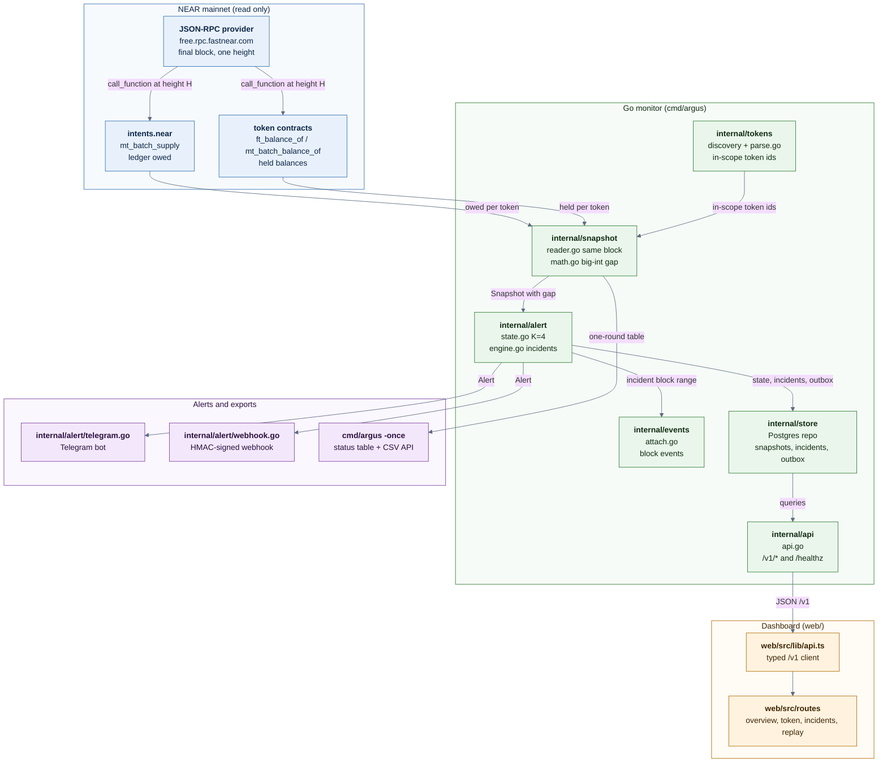

# Argus

A public solvency monitor for NEAR Intents. It checks, token by token, that `intents.near` really holds what its ledger says users own, and raises an alert when it does not. For anyone who wants to see the check instead of trusting a dashboard.


*Rendered from the dev mock API. The striped banner marks the numbers as made up.*

## Built for NEAR HACKATHON 2026

A working prototype built between 3 and 14 November 2026. The repository is public, the judge check runs without keys or a database, and every claim below has a test or a committed log behind it.

| Event requirement | Where it is met |
|---|---|
| A working prototype | `cmd/argus -once` ran a live mainnet round on 2026-11-14; `cmd/verify` replays a recorded incident offline |
| Uses NEAR | reads `intents.near` and NEP-141/NEP-245 contracts at one final block |
| Public and re-runnable | `go test ./...` and `go run ./cmd/verify` need no account, key, wallet or database |
| Evidence, not assertions | [`docs/CLAIMS.md`](docs/CLAIMS.md) maps every claim to code and proof; [`evidence/`](evidence/) holds the logs |

## The problem

On 2026-10-01 a failing deposit callback let an attacker keep ledger credit for deposits that had been refunded. Across 23 deposits that added up to roughly $3.8M of balances with nothing behind them, which were withdrawn as USDT on BNB Chain and returned about 36 hours later. NEAR Intents' monitoring compared bridge backing with NEAR-side totals, but not ledger totals with what the contract actually held. The deposit path has since been fixed ([near/intents@16d04f6](https://github.com/near/intents/commit/16d04f6ec4401263f8914638710260da50bb46b0)) and the team now runs that check internally.

Argus runs the same comparison in public, so anyone can see it, re-run it and subscribe to it.

The official postmortem could not be opened from the build environment, so the figures come from coverage that quotes it: [The Defiant](https://thedefiant.io/news/security/near-intents-postmortem-links-3-8-million-exploit-to-deposit-bug), [Crypto Times](https://www.cryptotimes.io/2026/10/17/near-intents-traces-3-8m-exploit-to-smart-contract-deposit-bug/), [KuCoin News](https://www.kucoin.com/news/flash/near-intents-releases-post-mortem-report-on-3-8m-vulnerability), [The Block](https://theblock.co/news/ecosystems/2026-10-01-near-intents-halts-services-after-3-8-million-exploit-promises-full-compensation-417404). More in [docs/research.md](docs/research.md).

## What it does

1. Discover the in-scope token ids from the `intents.near` token list. NFT ids are skipped. On 2026-11-14 this found 790 in-scope token ids.
2. At one final block, read what the ledger says users own with `intents.near.mt_batch_supply`, 50 ids per call.
3. At the same block, read what the contract actually holds with `ft_balance_of` (NEP-141) or `mt_batch_balance_of` (NEP-245) for the `intents.near` account.
4. Subtract in big-integer math on the raw strings. A non-negative gap is green. A negative gap is amber first.
5. After 4 consecutive negative snapshots, or an absolute deficit set in `ARGUS_RED_THRESHOLDS`, the token goes red. Argus opens an incident, queues Telegram and webhook alerts, and attaches the `intents.near` events from that block range.
6. Serve the result through `/v1/status`, `/v1/tokens`, `/v1/tokens/{id}/history`, `/v1/incidents`, `/v1/export.csv`, `/v1/replay` and `/v1/badge/{id}.svg`, and through the dashboard in `web/`.

A failed read marks the token stale and never resets its negative streak. Argus only reads. It never signs anything and holds no keys.

## Why NEAR is load-bearing

| NEAR feature | Role in the flow | File |
|---|---|---|
| `intents.near.mt_batch_supply` | the ledger side of every check | [`internal/snapshot/reader.go:355`](internal/snapshot/reader.go#L355) |
| NEP-141 `ft_balance_of` | the held side for fungible tokens | [`internal/tokens/held.go:26`](internal/tokens/held.go#L26) |
| NEP-245 `mt_batch_balance_of` | the held side for multi-tokens, batched per contract | [`internal/tokens/held.go:41`](internal/tokens/held.go#L41) |
| Final block, one height per round | deposits and withdrawals cannot show up as fake gaps | [`internal/snapshot/reader.go:166`](internal/snapshot/reader.go#L166) |
| neardata block events | incident context from the token and `intents.near` | [`internal/events/attach.go:36`](internal/events/attach.go#L36) |

Without the public ledger view on `intents.near` and the public balance views on the token contracts, there is nothing to compare. No indexer, vendor API or private key is required.

## What works now

| Claim | Code | Proof |
|---|---|---|
| Owed and held are read at the same final block | [`internal/snapshot/reader.go:166`](internal/snapshot/reader.go#L166), [`reader.go:355`](internal/snapshot/reader.go#L355) | `TestRoundBatching`; live round header names one block |
| The gap is exact big-integer subtraction | [`internal/snapshot/math.go:57`](internal/snapshot/math.go#L57) | `TestGap`, `TestRoundHugeValues` |
| Discovery skips NFTs and keeps NEP-141/NEP-245 | [`internal/tokens/parse.go:64`](internal/tokens/parse.go#L64), [`internal/tokens/discover.go`](internal/tokens/discover.go) | `TestEnumeration`; live round found 790 |
| Amber first, red after 4 negative snapshots | [`internal/alert/state.go:12`](internal/alert/state.go#L12), [`cmd/argus/config.go:155`](cmd/argus/config.go#L155) | `TestStepScenarios`; `cmd/verify` output |
| A read failure marks stale and keeps the streak | [`internal/alert/state.go`](internal/alert/state.go) | `TestEngineReadErrorsKeepStreak`, `TestStepErrorKeepsStreak` |
| Red opens an incident and queues alerts atomically | [`internal/alert/engine.go:108`](internal/alert/engine.go#L108), [`internal/alert/outbox.go`](internal/alert/outbox.go) | `TestEngineIncidentLifecycle`, `TestEngineAtomicOutboxFailureRedThenRecoverThenDeficit` |
| Telegram and HMAC-signed webhook channels | [`internal/alert/telegram.go`](internal/alert/telegram.go), [`internal/alert/webhook.go`](internal/alert/webhook.go) | PARTIAL: tested against local fake servers, not a real bot or endpoint |
| Read-only HTTP API | [`internal/api/api.go:109`](internal/api/api.go#L109) | `TestStatus`, `TestHistory`, `TestExportCSV` |
| Dashboard client matches the `/v1` shapes | [`web/src/lib/api.ts:227`](web/src/lib/api.ts#L227) | PARTIAL: check, 36 tests and build pass; screenshots and tests use `web/dev/mock-api.mjs`, not a live monitor. [`evidence/dashboard-checks-2026-11-14.txt`](evidence/dashboard-checks-2026-11-14.txt) |
| A full round ran against mainnet | [`cmd/argus/once.go`](cmd/argus/once.go) | [`evidence/live-round-2026-11-14.md`](evidence/live-round-2026-11-14.md) |
| 12 recorded rounds replay offline | [`cmd/verify`](cmd/verify) | [`evidence/verify-synthetic-2026-11-14.txt`](evidence/verify-synthetic-2026-11-14.txt) |
| Postgres store for snapshots, incidents and the outbox | [`internal/store`](internal/store) | PARTIAL: package tests pass, the 25 database tests skip without `ARGUS_TEST_*` URLs |
| Incident event attachment | [`internal/events/attach.go:36`](internal/events/attach.go#L36) | PARTIAL: unit tests pass, not exercised on a live incident |

## What's mocked or not built

- The dashboard screenshots come from `web/dev/mock-api.mjs`, not from mainnet. The striped banner says so.
- There is no hosted instance. The demo post shows a local run.
- Docker Compose is documented but was not started in this environment because Docker is not installed here.
- The 25 Postgres and Redis tests skip unless `ARGUS_TEST_DATABASE_URL` and `ARGUS_TEST_REDIS_URL` are set.
- `cmd/verify -capture` records a real round, but that path has not been run yet.
- The October replay in `cmd/replay` has not been run. It needs Postgres and archival RPC access.
- Origin-chain backing of bridged tokens, NFTs and `imt:` tokens are out of scope. Argus reads the NEAR side only.
- A live Telegram message and a live webhook POST have not been sent.
- The optional LLM incident summary is built but disabled by default and has not been exercised.
- There has been no 24/7 deployment. One live round is not an uptime claim.

## 30-second judge check

Requires Go 1.27.4 or newer. No API keys, wallet or database.

```sh
go test ./...
go run ./cmd/verify
```

The first run downloads Go modules. On this machine the whole check takes about 70 seconds. Expected tail:

```text
ok  	github.com/emma31-dev/argus/internal/snapshot	...
...
Expectations: PASS (7 final statuses, 7 transitions, 4 alerts match data\fixtures\synthetic\expected.json)

verify OK: 1 fixture set(s) replayed offline (no network used)
```

`cmd/verify` pushes 108 recorded RPC exchanges through the real reader and alert engine for 12 rounds, then compares the result with `expected.json`. The fixture is synthetic and labelled as such.

## Architecture



## Measured results

| Metric | Value | How measured | Log |
|---|---|---|---|
| Tokens discovered in scope | 790 | `go run ./cmd/argus -once` against mainnet | [`evidence/live-round-2026-11-14.txt`](evidence/live-round-2026-11-14.txt) |
| Tokens read / stale | 720 / 70 | same round | same |
| Status after the round | 705 green, 15 amber, 0 red | same round | same |
| Wall time, live round | about 9.5 minutes at 1 request per second | observed process start to exit | [`evidence/live-round-2026-11-14.md`](evidence/live-round-2026-11-14.md) |
| Go tests | 236 passed, 25 skipped, 0 failed | `go test ./... -count=1` | [`evidence/go-test-2026-11-14.txt`](evidence/go-test-2026-11-14.txt) |
| Static checks | vet, CGO-disabled build, `go mod tidy -diff`, gofmt clean | commands in the log | [`evidence/static-checks-2026-11-14.txt`](evidence/static-checks-2026-11-14.txt) |
| Dashboard | 0 errors, 36 tests, build passes | `pnpm check`, `pnpm test`, `pnpm build` | [`evidence/dashboard-checks-2026-11-14.txt`](evidence/dashboard-checks-2026-11-14.txt) |
| Synthetic replay | 12 rounds, 7 transitions, 4 alerts, all match | `go run ./cmd/verify` | [`evidence/verify-synthetic-2026-11-14.txt`](evidence/verify-synthetic-2026-11-14.txt) |

The 70 stale reads were 59 contract methods not found, 9 accounts or contract code not found, and 2 execution failures. 55 of them are one test contract, `nep245:test1779579480756.near`. Argus reports those tokens as stale instead of pretending they are healthy.

## Built during the hackathon vs pre-existing

- Built during NEAR HACKATHON 2026 (3 to 14 November 2026): the Go monitor, snapshot reader, alert engine, HTTP API, Postgres store, replay tooling, fixtures, SvelteKit dashboard, screenshots and documentation in this repository.
- Pre-existing: the Go standard library and the Go modules in `go.mod`, the SvelteKit and Tailwind toolchain, D3 for charts, and the public NEAR contracts and RPC endpoints that the monitor reads. None of the application code predates the hackathon.

## Full setup

### Environment variables

See [`.env.example`](.env.example). The judge path needs none of them. To run the monitor you need `DATABASE_URL`. `ARGUS_RPC_URLS`, `ARGUS_RPC_RPS`, `ARGUS_INTERVAL`, `ARGUS_DEBOUNCE_K`, `ARGUS_BATCH_SIZE` and `ARGUS_CONCURRENCY` have working defaults. Telegram, webhooks, Redis, neardata events and the LLM summary are optional and off unless configured.

### Run locally

Full stack with Docker:

```sh
Copy-Item .env.example .env
docker compose up --build
```

That starts Postgres, Redis, the monitor on `:8080` and the dashboard on `:3000`.

Without Docker you need Go 1.27.4+, Postgres 16, and optionally Redis 7. The dashboard needs Node 22.17+ and pnpm 10.

```sh
go build -o bin/argus ./cmd/argus
DATABASE_URL=postgres://... ./bin/argus
cd web
pnpm install
pnpm dev
```

The dev server runs on `:5173` and proxies `/v1` to `:8080`. `pnpm dev:mock` runs the dashboard against made-up data with no backend.

Live checks against mainnet (read-only):

```sh
go run ./cmd/probe all
go run ./cmd/probe archival -date 2026-10-01
```

Replaying October:

```sh
go run ./cmd/replay -find-heights 2026-09-29T16:00:00Z,2026-10-01T06:00:00Z
Copy-Item data/replay/plan.example.yaml data/replay/plan.yaml
go run ./cmd/replay
```

### Deploy

The runtime pieces are the Go monitor (`cmd/argus`, port 8080), Postgres, optional Redis, and the static dashboard in `web/`. [docs/deploy.md](docs/deploy.md) documents a Fly.io, hosted Postgres/Redis and Cloudflare Pages setup. The Fly config in [`deploy/fly/fly.toml`](deploy/fly/fly.toml) has not been deployed.

### Security notes

- Argus is read-only. It has no signing code, no wallet and no private keys.
- The HTTP API is read-only and rate-limited (`ARGUS_API_RATE_LIMIT`, default 60 requests per minute per client).
- Webhook payloads are signed with HMAC-SHA256. `TELEGRAM_BOT_TOKEN`, `LLM_API_KEY` and `DATABASE_URL` come from the environment and are never committed.
- The free public RPC is rate-limited. A provider that answers 429 is put on a cooldown, and the round carries on or moves to the next provider.
- Non-archival nodes only go back about 36 hours. The October replay needs an archival endpoint.
- Tokens without metadata show raw amounts. A fee-on-transfer or rebasing token could stay red without anything being wrong.

### Roadmap

- Run the Docker stack and the 25 database tests against real Postgres and Redis.
- Run the October replay with archival RPC and commit the report.
- Capture a real incident fixture with `cmd/verify -capture`.
- Add origin-chain backing checks for bridged tokens.
- Deploy a hosted instance with a keyed RPC endpoint.

### Docs index

- [`docs/CLAIMS.md`](docs/CLAIMS.md): every claim mapped to code and proof.
- [`evidence/README.md`](evidence/README.md): what each committed log proves.
- [`structure.md`](structure.md): folder map and where each piece of logic lives.
- [`docs/api.md`](docs/api.md): HTTP API reference.
- [`docs/deploy.md`](docs/deploy.md): deployment notes.
- [`docs/research.md`](docs/research.md): day-0 sponsor research and contract quirks.
- [`docs/architecture.mmd`](docs/architecture.mmd): Mermaid source for the diagram above.
- [`web/README.md`](web/README.md): dashboard commands and mock API.

MIT, see [LICENSE](LICENSE).
