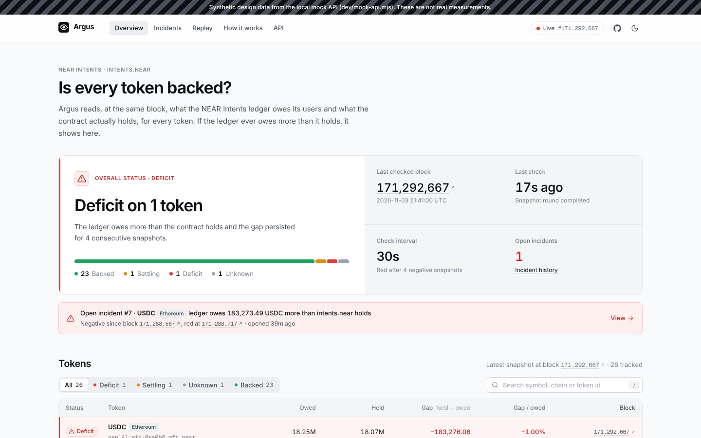
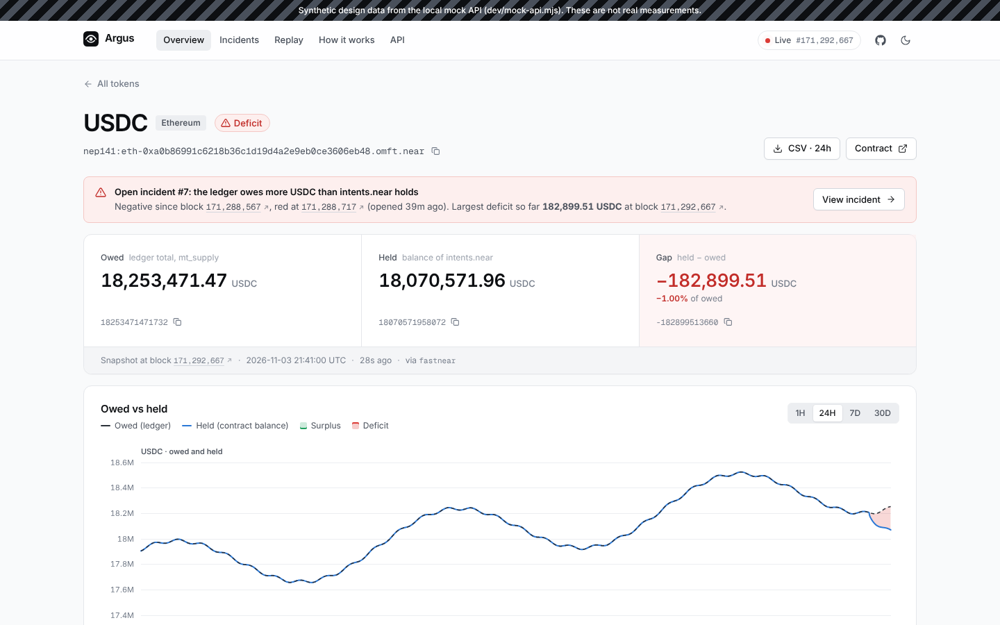
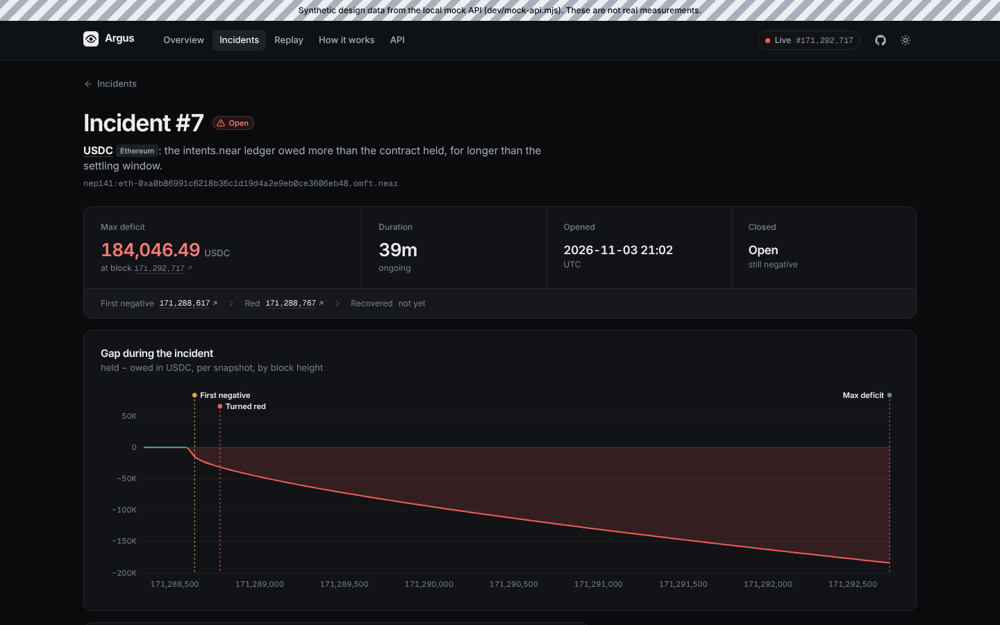
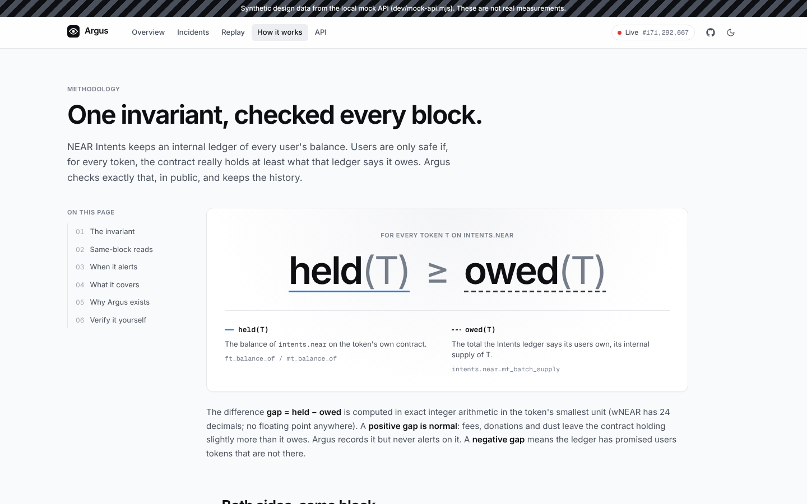
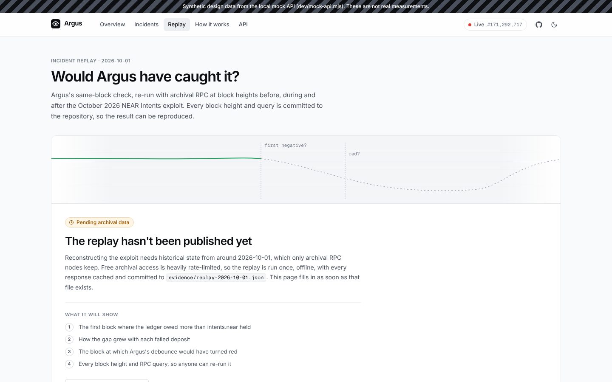
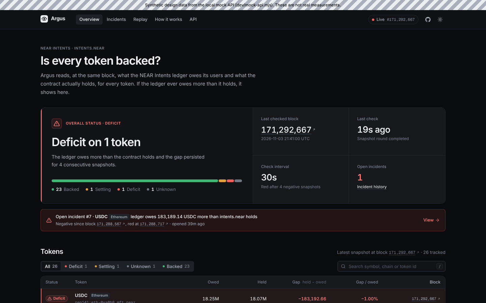
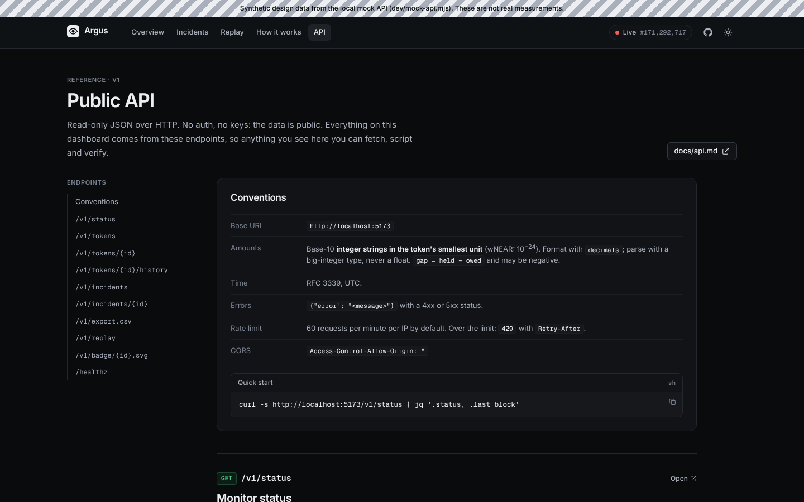
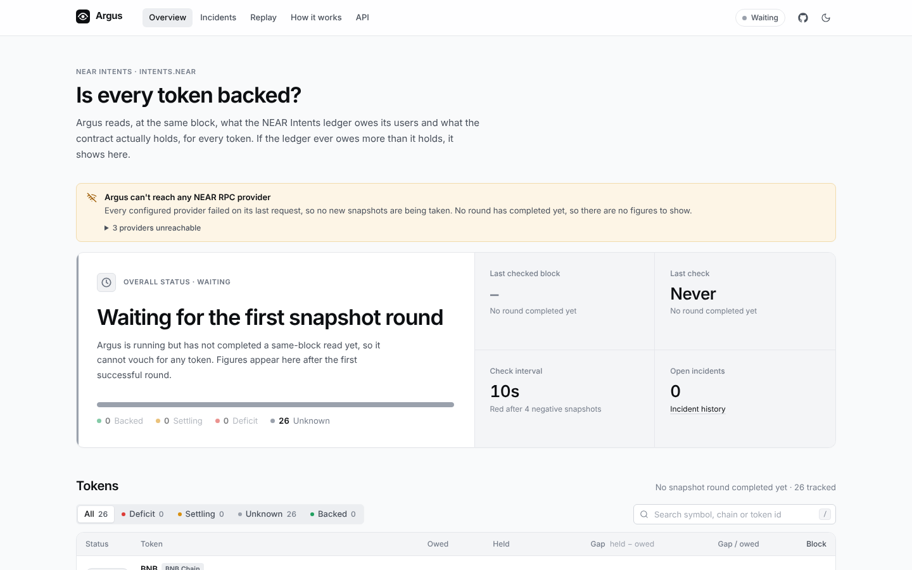

# Argus dashboard

The public, read-only dashboard for Argus: for every token on NEAR Intents (`intents.near`), is
`held(T) ≥ owed(T)` at the same block? SvelteKit 2 + Svelte 5 (runes), TypeScript, built to a fully
static site that reads the [Argus API](../docs/api.md) from the browser.



> Every screenshot here is rendered against the dev mock API and shows **synthetic data**
> (the striped banner at the top says so). They show the design, not real measurements.

| | |
|---|---|
|  |  |
|  |  |
|  |  |

Phone width: [overview](docs/screenshots/overview-390-light.png), [token](docs/screenshots/token-390-light.png).

Real output: the dashboard against the actual Go backend in a sandbox where every NEAR RPC provider is
blocked. No round has completed, so it says so and shows no figures:



## Develop

Requires Node 20+ and pnpm 10.

```sh
pnpm install
pnpm dev:mock     # mock API on :8080 + vite on :5173 (no backend needed)
pnpm dev          # vite only; proxies /v1 to http://localhost:8080 (the Go server)
```

`dev/mock-api.mjs` serves **synthetic design data** shaped exactly like `docs/api.md`, using the real
token ids from `config/tokens.yaml` with invented amounts. It lives outside `src/`, nothing in the app
imports it, and it is never part of the build. Runtime switches for testing states:
`curl 'localhost:8080/__mock?scenario=ok|incident&replay=0|1&stale=0|1&down=0|1'`.

```sh
pnpm check        # svelte-check (types + a11y), must be 0 errors / 0 warnings
pnpm test         # vitest: BigInt amount formatting, chain labels
pnpm build        # static site in build/
pnpm preview      # serve build/ (also proxies /v1)
node dev/screenshots.mjs [outDir] [--only=overview,token] [--widths=1440,390] [--themes=light,dark] [--full]
# BASE_URL (default http://localhost:5173) and MOCK_URL (default http://localhost:8080) are configurable,
# e.g. run the mock on another port: MOCK_PORT=8081 ARGUS_API_PROXY=http://localhost:8081 pnpm dev:mock
```

Note: `vite preview` indexes `build/` when it starts, so restart it after every `pnpm build`.

The screenshot script uses the Playwright + Chromium installed on the machine; it is not a project
dependency.

## Configuration

| Variable | Default | Meaning |
|---|---|---|
| `PUBLIC_API_BASE` | `''` (same origin) | Base URL of the Argus API, baked in at build time, e.g. `https://api.example.org` |
| `BASE_PATH` | `''` | Serve the site under a sub-path, e.g. `/argus` |
| `ARGUS_API_PROXY` | `http://localhost:8080` | Dev/preview proxy target for `/v1` |

## Routes

| Path | Page |
|---|---|
| `/` | Overview: overall status, last checked block, live "time since check", token table sorted by deficit risk |
| `/token/?id=<url-escaped token id>` | Token detail: owed vs held chart (1H/24H/7D/30D), current numbers with raw values, open incident, metadata, CSV, the exact RPC calls |
| `/incidents/` | Incident history |
| `/incident/?id=<n>` | Incident detail: gap chart with milestones, timeline of state changes and intents.near events, snapshots |
| `/how-it-works/` | Methodology explainer with diagrams |
| `/replay/` | October 2026 incident replay (`/v1/replay`), with a designed "pending archival data" state for the 404 |
| `/api/` | API reference |

Ids travel in the query string so every route is a prerendered file (`token/index.html`), servable
by any static host; `404.html` is the SPA fallback shell. Example link for alerts:
`https://<host>/token/?id=nep141%3Awrap.near`.

## How numbers are handled

API amounts are base-10 integer strings in the token's smallest unit (wNEAR: 24 decimals), often
beyond `Number.MAX_SAFE_INTEGER`. `src/lib/format.ts` parses them with `BigInt` and does all
rounding, percentages and formatting in integer arithmetic. Numbers only become JS floats in
`toTokenNumber`, for chart geometry, after scaling to whole tokens. Every displayed amount carries
its exact value and raw integer in a tooltip; token pages show the raw values with copy buttons.

The dashboard never invents numbers: loading shows skeletons; an unreachable API shows "Monitor
offline" with retry; before the first round the header reads "Waiting" and the overview says no
round has completed; `monitor_stale` (or, as a fallback, data older than 3x the interval) turns the
header to "Stale" with a warning; when every RPC provider is unhealthy a banner lists each host and
its error; a token whose last read failed (`stale: true`) gets a one-line summary with the raw
error in a disclosure.

## Design system

All tokens are CSS custom properties in `src/lib/styles/tokens.css`; base styles and primitives are in
`src/lib/styles/base.css`. No UI kit, no Tailwind.

- **Colour.** Neutral, slightly cool greys carry the interface. Colour carries meaning only: green
  `--ok` (backed), amber `--warn` (settling), red `--bad` (deficit), grey `--unk` (unknown). Each status
  has a text-safe ink, a `-mark` for dots and bars, a `-bg` tint and a `-border`. Status is never shown
  by colour alone: badges pair it with an icon and a label. The one non-status hue is blue: the
  `--series-held` chart line and `--accent` for focus. `--series-owed` is the ink colour, dashed.
- **Themes.** Light and dark are both hand-picked (dark is not an inversion). Dark applies for
  `prefers-color-scheme: dark` unless the user chose light, and whenever `data-theme="dark"` is set.
  The toggle persists to `localStorage` (wrapped in try/catch) and an inline script applies it before
  first paint.
- **Type.** Inter (UI, tabular figures in columns) and Geist Mono (ids, block heights, raw values,
  code), both self-hosted via Fontsource. Scale: 11 / 12 / 13 / **14 (body)** / 15 / 17 / 20 / 26 / 34 / 46 px,
  tight negative tracking on headings.
- **Space and shape.** 4px grid (`--s-1` 4px to `--s-24` 96px). Radius 4 / 6 / 8 / 12px. Hairline
  1px borders; almost no shadows.
- **Layout.** 1200px container, 16px gutters on phones and 32px from 768px. Tables become card lists
  below 880px; diagrams switch to vertical variants below 640px; nothing scrolls horizontally at
  360px.
- **Charts.** Hand-built SVG with `d3-scale`/`d3-shape`: 2px lines, hairline grid, the gap area green
  above zero and red below (clip paths at the zero line), a red mark on every negative snapshot,
  crosshair tooltip, and full keyboard support (focus the chart, arrows to move, Home/End, `N` for
  the next negative snapshot, Esc to clear).

## Layout of `src/`

```
lib/
  api.ts            typed client for /v1 (+ ApiError, offline detection)
  format.ts         BigInt amount formatting (tested in format.test.ts)
  chain.ts          chain label fallback for objects that only carry a token id
  live.svelte.ts    shared clock, Resource (keeps last good value), poll()
  monitor.svelte.ts app-wide /v1/status, staleness
  theme.svelte.ts   theme toggle
  components/       Amount, BlockLink, StatusBadge, TokenTable, TokenChart, GapChart, RpcProof, ...
  components/diagrams/  SameBlock, Debounce (inline SVG, wide + narrow variants)
routes/             one folder per page (see Routes)
```
